# Laporan Praktikum Pertemuan 11 - Branching, Unit Test & CI/CD
**Proyek:** RutinKu (Aplikasi Manajemen Kebiasaan)
**Repository:** [github.com/Hengkylin/Rutinku](https://github.com/Hengkylin/Rutinku)
**Tanggal:** 26 November 2026

## 1. Ringkasan
Pada pertemuan 11, RutinKu dikembangkan dengan alur tiga branch (`v1.0` → `v1.0_dev` → `v1.1`). Unit test ditambah menjadi **206**, dan pipeline CI/CD (GitHub Actions) otomatis menguji, mem-build, lalu men-deploy APK **hanya jika semua tes hijau**. Demo bug yang dibuat dengan sengaja membuktikan bahwa unit test yang gagal memblokir build dan deploy, sehingga versi Live tidak tersentuh build yang rusak.

Target tugas:
1. Minimal 10 issue di GitHub Issues, minimal 5 di antaranya bug.
2. Branch `v1.0` sebagai rilis yang sudah OK.
3. Branch `v1.0_dev` untuk fitur dan perbaikan bug: sekitar 200 unit test, dan jika semua hijau maka otomatis build → deploy → Live untuk diuji.
4. Menunjukkan efek unit test yang gagal, beserta screenshot.
5. Branch `v1.1` sebagai rilis berikutnya.

## 2. Issue / Bug di GitHub Issues
Issue dicatat di GitHub Issues dan ditutup otomatis lewat kata kunci `closes #N` di pesan commit.

| # | Jenis | Issue | Commit perbaikan |
| --- | --- | --- | --- |
| #4 | Bug | Streak gagal ter-reset saat pergantian hari lewat pukul 00:00 | `4ec5f42` |
| #5 | Bug | Form rutinitas menerima nama kosong / hanya spasi | `0242f46` |
| #6 | Bug | Data checklist harian hilang setelah aplikasi di-force close | `c098ec1` |
| #7 | Bug | Notifikasi pengingat tetap muncul padahal rutinitas sudah selesai | `6df2790` |
| #8 | Bug | Ringkasan & grafik analitik terpotong di layar < 360dp | `5208c4f` |
| #1 | Perbaikan | Folder `.vscode/` ikut ter-push ke repo | `3816ced` |
| #2 | Perbaikan | Belum ada file LICENSE | `0794729` |
| #3 | Fitur | Belum ada setup CI/CD (GitHub Actions) | `e4cd4e9` |
| #9 | Fitur | Atur & hapus jam pengingat per rutinitas | `01eff4c` |

## 3. Strategi Branch

| Branch / tag | Fungsi | Versi | Status |
| --- | --- | --- | --- |
| `main` / `v1.0` | Rilis yang sudah OK (sama dengan tag `v1.0.0-rc.2`) | 1.0.0-rc.2+4 | ✅ Release OK |
| `v1.0_dev` | Penambahan fitur & perbaikan bug yang sedang diuji; setiap push hijau otomatis Live di `dev-latest` | 1.1.0-dev.1+5 | 🧪 Under testing |
| `v1.1` / tag `v1.1.0`, `v1.1.1` | Rilis berikutnya hasil `v1.0_dev` | 1.1.0+6 → 1.1.1+7 | ✅ v1.1.0, lalu hotfix v1.1.1 (Latest) |

## 4. Unit Test: 206 Tes
Di branch `v1.0_dev` ditambahkan **39 unit test** baru di `rutinku_flutter/test/habit_model_test.dart`, sehingga total tes naik dari 167 menjadi **206**. Tes baru menguji logika inti dengan tanggal acuan tetap, supaya hasilnya tidak bergantung pada jam perangkat.

| Kelompok | Jumlah tes | Yang diuji |
| --- | --- | --- |
| HabitRecord | 7 | Nilai default, toMap/fromMap, data lama, copyWith, kesamaan objek |
| Serialisasi HabitModel | 7 | JSON bolak-balik, format lama `completedDates`, nilai default, copyWith |
| Status harian | 5 | Selesai untuk target 1 vs progresif, hari istirahat, tanggal tanpa jam |
| toggleCheckIn | 6 | Centang/batal, data refleksi tidak hilang, aturan target progresif, immutable |
| incrementProgress | 5 | +1 progres, otomatis selesai saat target tercapai, immutable |
| streakCountOn | 7 | Berturut-turut, toleransi hari berjalan, putus, hari istirahat menjembatani |
| weeklyProgressOn | 2 | Progres 7 hari terakhir |

## 5. Pipeline CI/CD (GitHub Actions)
Workflow `.github/workflows/flutter-ci.yml` aktif untuk push dan pull request ke `main`, `v1.0`, `v1.0_dev`, dan `v1.1`, serta untuk tag `v*`. Unit test menjadi **gerbang**: build hanya berjalan jika semua tes lulus, dan deploy hanya berjalan jika build berhasil.

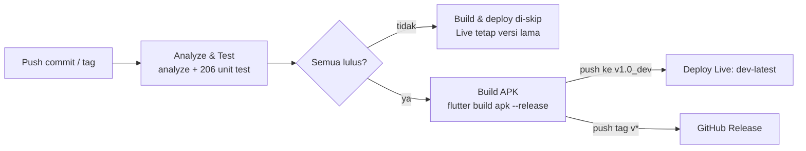

* Setiap run menampilkan tabel **Total / Passed / Failed / Skipped** beserta daftar tes yang gagal di halaman ringkasannya.
* Push hijau ke `v1.0_dev` otomatis mengganti APK di pre-release **dev-latest** (Live, siap diuji tester).
* Tag versi (mis. `v1.1.0`) menghasilkan GitHub Release resmi.
* Cache Gradle dan percobaan ulang build (maks. 3 kali) menjaga pipeline tetap stabil saat Maven Central membatasi unduhan (error 429).

## 6. Hasil 1: Semua Tes Hijau → Auto Build → Deploy → Live
Push pertama ke `v1.0_dev` (commit `103ae4b`, run #11) lolos **206/206** unit test, lalu otomatis mem-build APK dan men-deploy-nya ke pre-release **dev-latest** dalam 6 menit 8 detik.

| Job | Hasil | Durasi |
| --- | --- | --- |
| Analyze & Test | ✅ 206 passed, 0 failed | 1m 10s |
| Build APK | ✅ | 4m 38s |
| Deploy Live (dev-latest) | ✅ `RutinKu-dev-latest.apk` (56,6 MB) | 13s |
| GitHub Release | ⏭️ Skipped (khusus tag) | 0s |

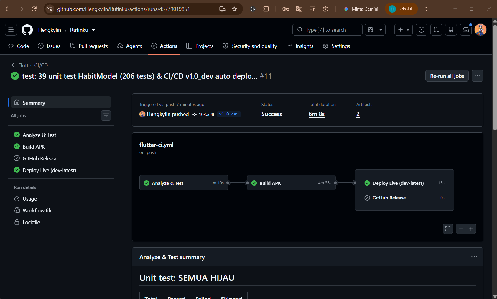
*Gambar 1. Run #11 di branch v1.0_dev: ketiga job hijau.*

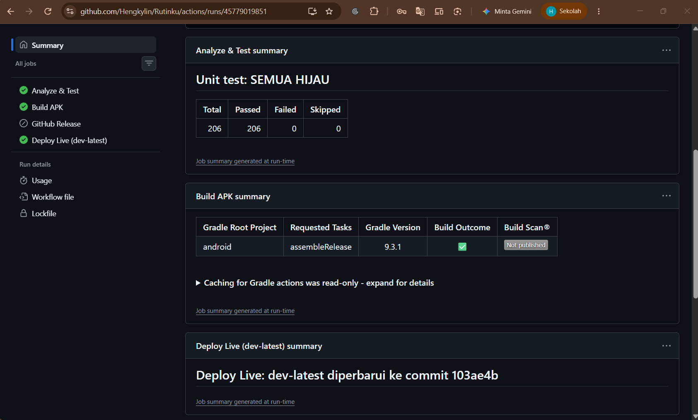
*Gambar 2. Ringkasan run #11: Unit test SEMUA HIJAU (206/206), lalu dev-latest diperbarui ke commit 103ae4b.*

## 7. Hasil 2: Unit Test Gagal dan Efeknya
Commit `ce34e22` sengaja memasukkan bug di `HabitModel.streakCountOn`: hari istirahat (*rest*) tidak lagi menjembatani streak.

| Tes yang gagal | Expected | Actual |
| --- | --- | --- |
| `checkin_test.dart`: streakCount preserves streak when a day is marked as rest | 1 | 0 |
| `habit_model_test.dart`: hari istirahat (rest) menjembatani tanpa menambah hitungan | 2 | 1 |

**Efek yang terlihat:**
1. **Di laptop**, `flutter test` menghasilkan 204 lulus dan 2 gagal, lengkap dengan nilai Expected/Actual, sehingga developer tahu persis aturan mana yang rusak.
2. **Di CI (run #12)**, Analyze & Test ❌ setelah 1m 23s. Ringkasannya menampilkan *Unit test: ADA YANG GAGAL* (Total 206, Passed 204, Failed 2) beserta nama tesnya.
3. **Build APK dan Deploy Live otomatis di-skip**, sehingga tidak ada APK yang dibuat dari kode yang rusak.
4. **Versi Live tidak berubah**: pre-release `dev-latest` tetap di commit `103ae4b`. Tester dan pengguna tidak pernah menerima build yang rusak.

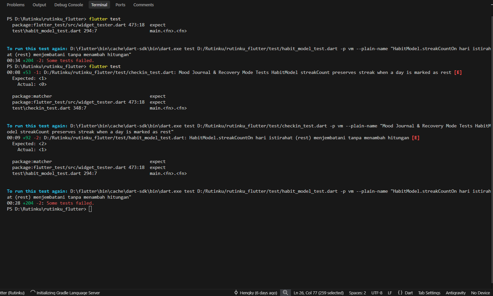
*Gambar 3. flutter test di laptop setelah bug dimasukkan: +204 -2, Some tests failed.*

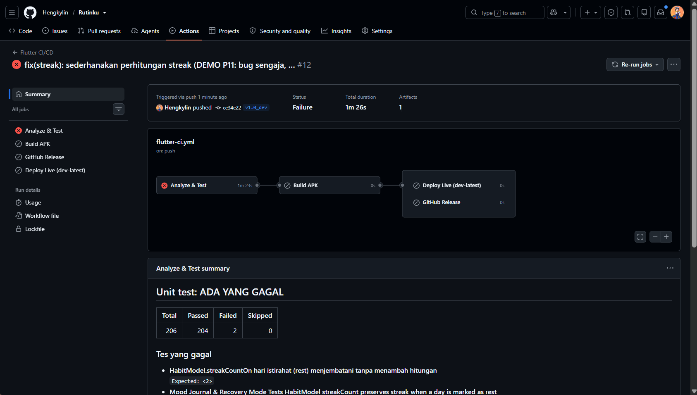
*Gambar 4. Run #12: Analyze & Test gagal, Build APK dan Deploy Live di-skip.*

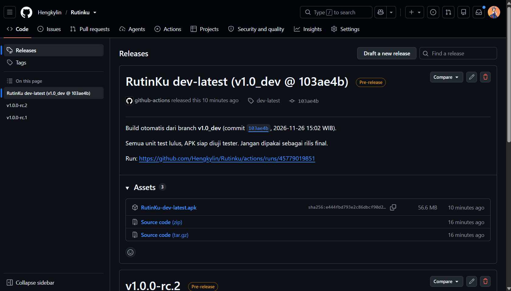
*Gambar 5. Setelah run #12, dev-latest tetap di commit 103ae4b.*

## 8. Hasil 3: Perbaikan dan Rilis v1.1
Bug diperbaiki dengan `git revert` (commit `ec797b5`, run #13): 206/206 tes kembali hijau dan `dev-latest` otomatis diperbarui. Setelah itu branch `v1.1` dibuat dari `v1.0_dev`, versinya dinaikkan menjadi 1.1.0+6, dan tag `v1.1.0` di-push (run #15). Hasilnya adalah rilis resmi **v1.1.0** (*Latest*) berisi `RutinKu-v1.1.0.apk`.

| Run | Branch / tag | Commit | Tes | Build | Deploy / Release |
| --- | --- | --- | --- | --- | --- |
| #15 | tag `v1.1.0` | `ce52172` | 206/206 ✅ | ✅ | GitHub Release v1.1.0 |
| #13 | `v1.0_dev` | `ec797b5` (revert) | 206/206 ✅ | ✅ | dev-latest diperbarui |
| #12 | `v1.0_dev` | `ce34e22` (bug demo) | 204 ✅ / 2 ❌ | ⏭️ | ⏭️ Live tetap `103ae4b` |
| #11 | `v1.0_dev` | `103ae4b` | 206/206 ✅ | ✅ | dev-latest dibuat |

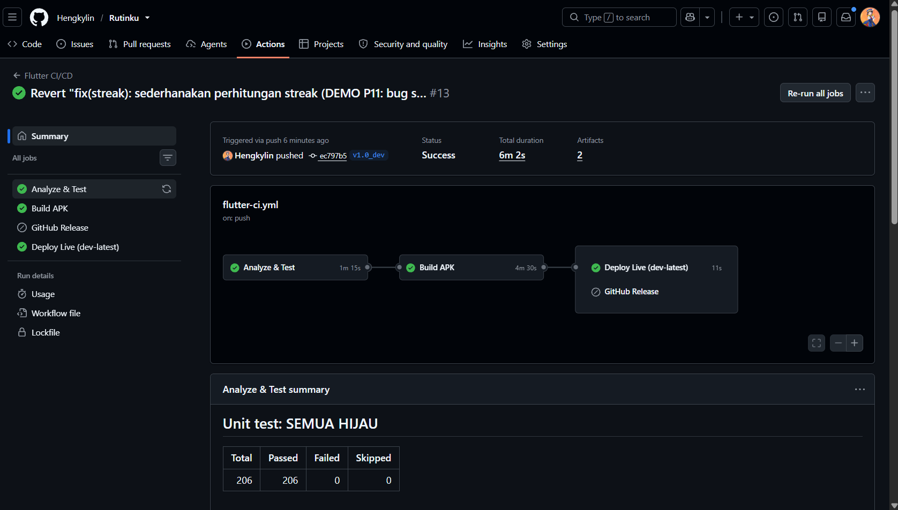
*Gambar 6. Run #13 (revert): kembali hijau 206/206 dan Deploy Live dijalankan lagi.*

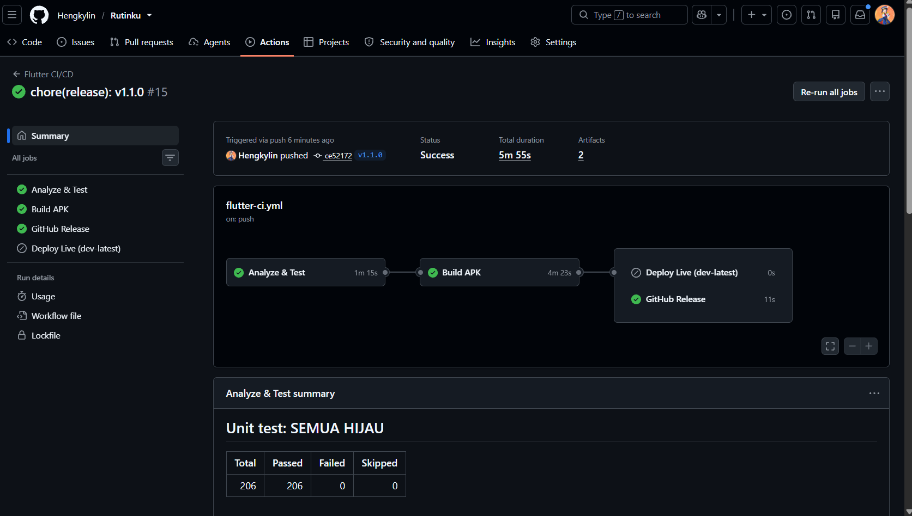
*Gambar 7. Run #15 untuk tag v1.1.0: Build APK dan GitHub Release hijau.*

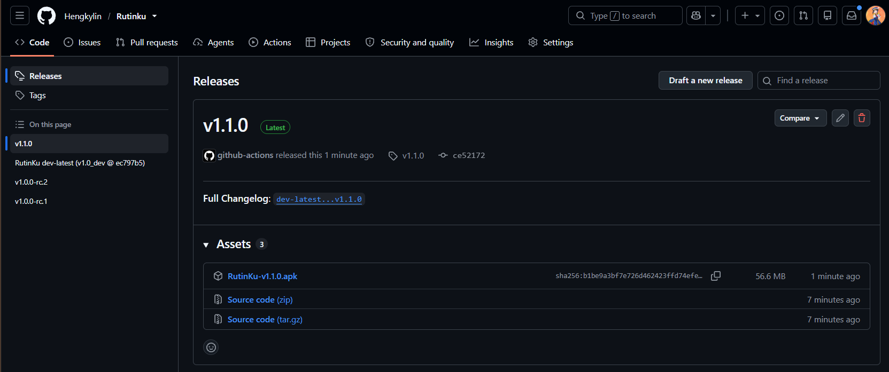
*Gambar 8. Halaman Releases: v1.1.0 (Latest) berisi RutinKu-v1.1.0.apk.*

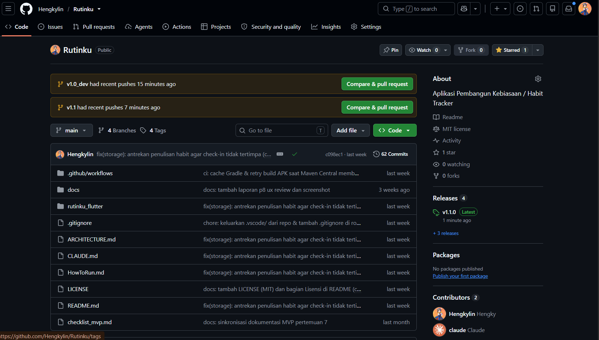
*Gambar 9. Halaman repo: 4 branch (main, v1.0, v1.0_dev, v1.1), 4 tag, rilis terbaru v1.1.0.*

## 9. Hasil 4: Pengujian APK Live dan Hotfix v1.1.1
Pengujian APK di HP menemukan 3 masalah yang tidak terlihat saat development. Ketiganya diperbaiki di `v1.0_dev`, lolos **222/222** tes, terbukti berhasil di APK `dev-latest`, lalu dirilis sebagai **v1.1.1**. Bug terberat hanya muncul di build release: APK v1.1.0 sama sekali tidak bisa login.

| Temuan di HP | Penyebab | Perbaikan | Tes baru | Commit |
| --- | --- | --- | --- | --- |
| Garis "OVERFLOWED BY 8.8 PIXELS" di kartu rutinitas | Baris "Tanpa pengingat" dan streak memakai `Row` kaku di kolom sempit dengan huruf HP besar | Teks dibungkus `Flexible` sehingga bisa turun baris | 3 | `0c64f00` |
| Ikon lonceng tidak bisa diketuk | Ikon hanya hiasan tanpa aksi | Halaman Pengingat: jadwal per jam, status hari ini, atur jam, cek izin | 7 | `fdadc9c` |
| Login APK release gagal: "Failed host lookup" | Izin `INTERNET` hanya ada di manifest debug/profile, tidak di manifest main yang dipakai release | Izin ditambahkan, error jaringan diganti pesan ramah, plus tes penjaga yang membaca manifest | 6 | `461f651` |

| Run | Branch / tag | Commit | Tes | Hasil |
| --- | --- | --- | --- | --- |
| #21 | `v1.0_dev` | `461f651` | 222/222 ✅ | dev-latest diperbarui, login di HP berhasil |
| #20 | `v1.0_dev` | `fdadc9c` | 216/216 ✅ | dev-latest diperbarui |

Setelah teruji di HP, `v1.0_dev` digabung ke `v1.1` (merge `41db4ce`), versi dinaikkan menjadi 1.1.1+7, dan tag `v1.1.1` dibuat. **Pelajaran:** unit test tidak menangkap bug yang hanya ada di konfigurasi build release. Karena itu kini ada tes penjaga manifest, sehingga APK tanpa izin INTERNET tidak akan lolos CI ke Live lagi.

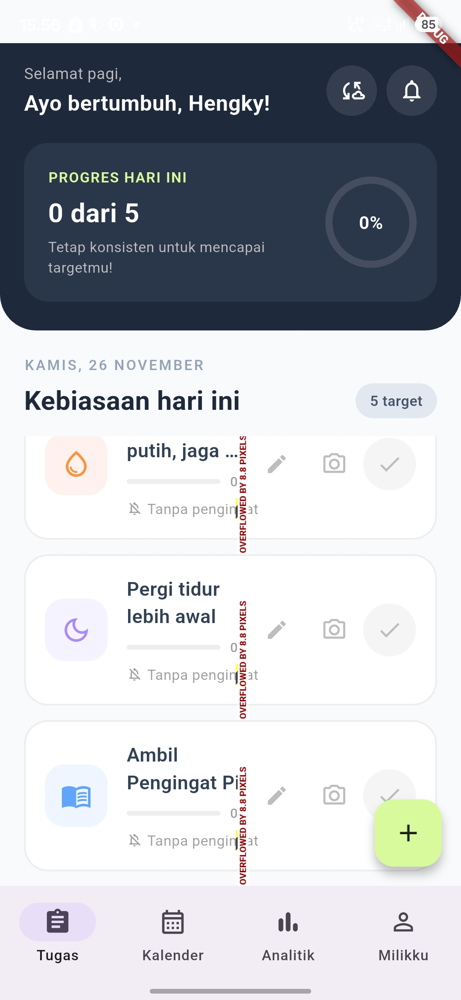
*Gambar 10. Sebelum perbaikan: baris "Tanpa pengingat" overflow 8,8 piksel di kartu rutinitas.*

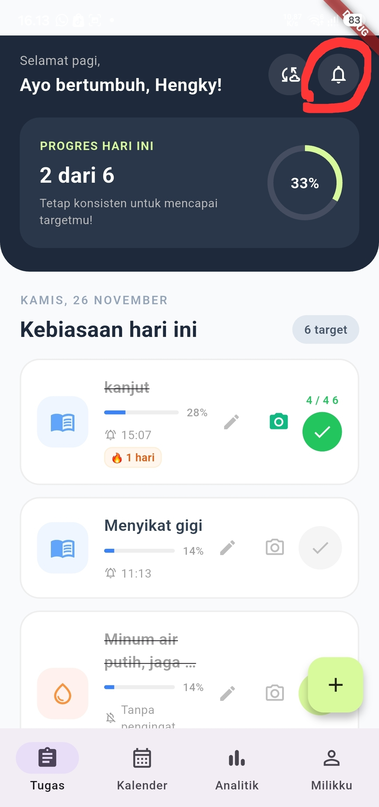
*Gambar 11. Ikon lonceng (dilingkari) belum memiliki aksi.*

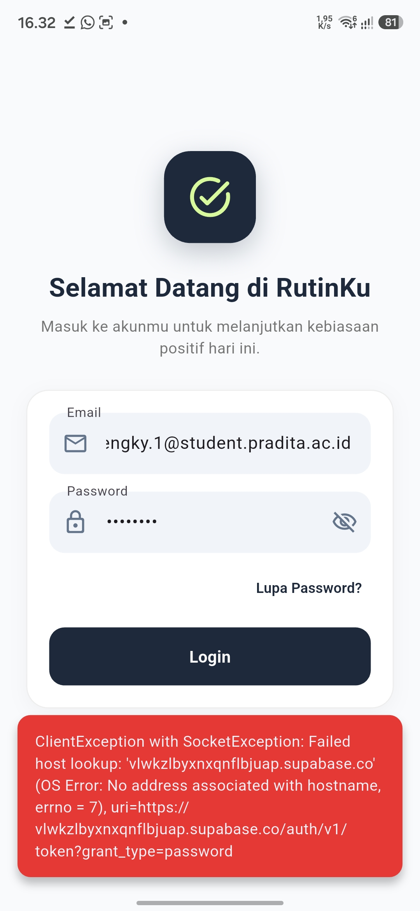
*Gambar 12. APK release gagal login karena izin INTERNET tidak ada di manifest main.*

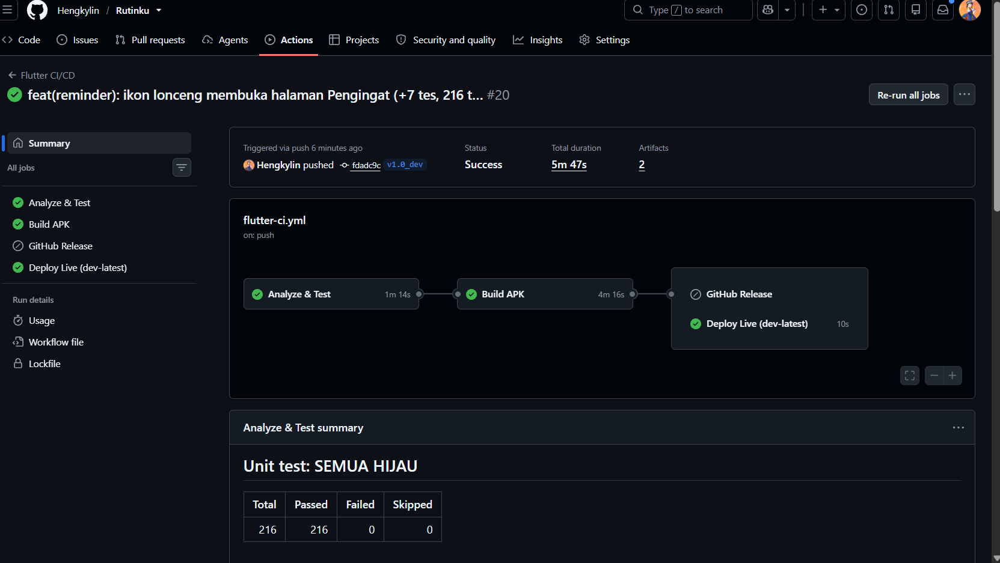
*Gambar 13. Run #20 (halaman Pengingat): 216/216 lulus dan Deploy Live hijau.*

*Gambar 14. Run #21 (izin INTERNET): 222/222 lulus dan Deploy Live hijau.*

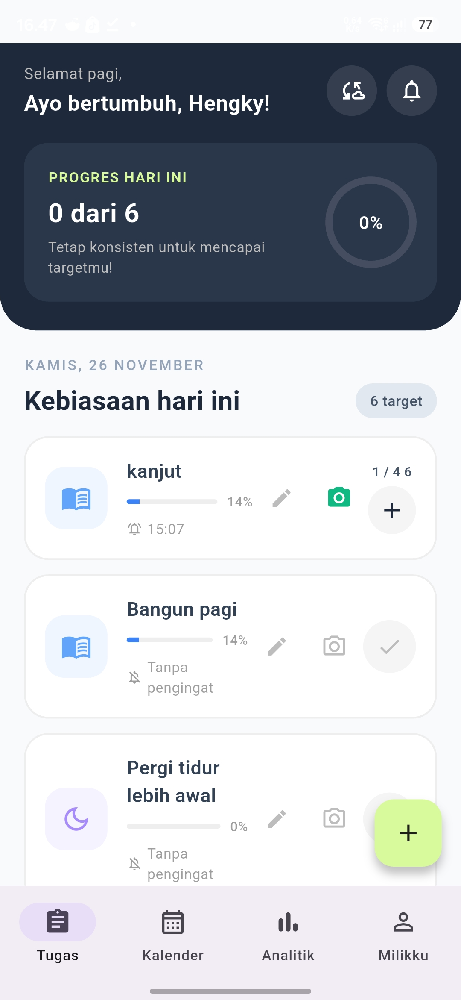
*Gambar 15. APK dev-latest di HP: login berhasil, "Tanpa pengingat" turun baris dengan rapi, dan lonceng aktif.*

## 10. Kesimpulan
Semua target P11 tercapai, dan pengujian APK Live menghasilkan hotfix v1.1.1 dengan 222 tes: issue tercatat dan ditutup lewat commit, branch `v1.0` / `v1.0_dev` / `v1.1` terpisah, 206 unit test berjalan otomatis, dan pipeline CI/CD hanya men-deploy build yang lolos semua tes. Demo bug membuktikan bahwa unit test yang gagal memblokir build dan deploy, sehingga kesalahan ditemukan oleh developer, bukan oleh tester atau pengguna.
